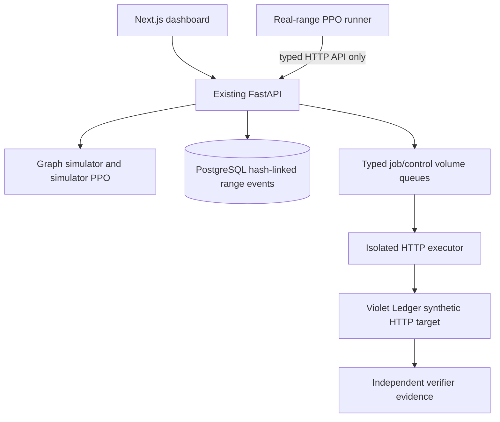

# Architecture

The real-range learner is a client of the current API. It cannot import target internals as an environment shortcut. Red proposals map to `RangeAction` contracts; Blue can choose no-op or ownership hardening in the first supported learning task. The API persists each transition as `learning_transition` in the same sequence and hash chain used by executor records. A proposed action that fails execution is still logged but the PPO agent excludes it from the on-policy training batch.

Compose keeps the executor on the internal `range` network with the target. The executor has no database credentials or arbitrary destination input. The target database, control plane database, and executor queues use separate services/volumes. Local API and UI ports bind to `127.0.0.1`.
